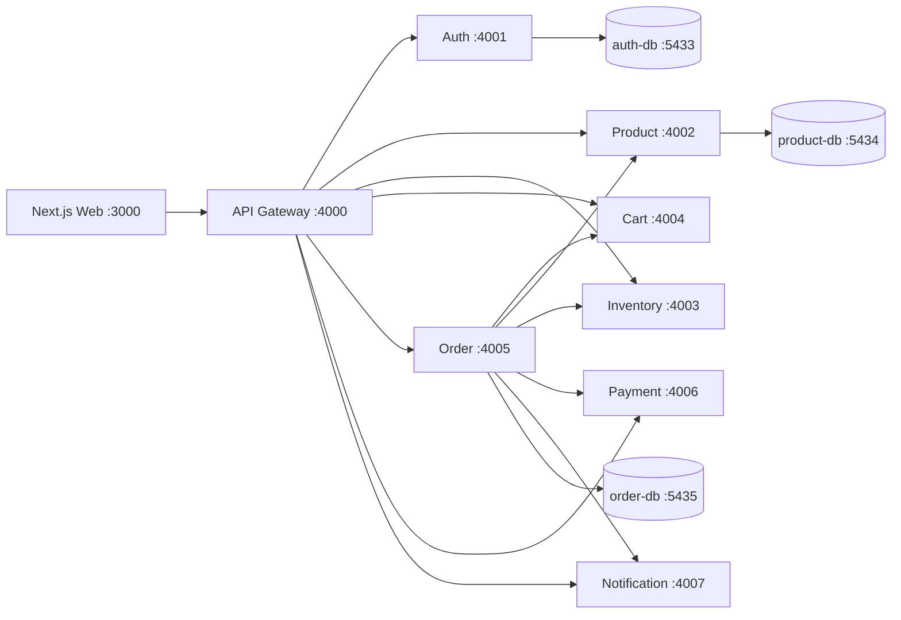

# Phase 7 — Final HTTP-Only Integration

## Final architecture



## Ports

| Component | Port | Persistence |
|---|---:|---|
| Web | 3000 | None |
| API Gateway | 4000 | None |
| Auth | 4001 | auth-db 5433 |
| Product | 4002 | product-db 5434 |
| Inventory | 4003 | In-memory |
| Cart | 4004 | In-memory |
| Order | 4005 | order-db 5435 |
| Payment | 4006 | In-memory |
| Notification | 4007 | Console only |

## Full request flow

The browser calls only the gateway. The gateway forwards method, body, query, JWT, admin header, and request ID. Checkout uses Cart → Product → Inventory check → Order PENDING → Payment → Inventory reduction → Order CONFIRMED → Cart clear → Notification log. Notification failure does not cancel a confirmed order. Inventory failure after payment produces a FAILED order and demonstrates the consistency limitation of independent HTTP calls.

## Docker setup

`docker-compose.yml` contains health checks for all databases and backend services, Docker service-name URLs, migration/seed one-shot containers, dependency health conditions, and host ports. It does not perform destructive resets.

Start everything:

```bash
docker compose up --build -d
```

Inspect status:

```bash
docker compose ps
```

## Validation evidence

Passed:

- `pnpm install`
- `pnpm typecheck`
- `pnpm build`
- `pnpm -r test`
- `docker compose config`

The final Docker command was attempted twice. Both attempts failed during parallel `pnpm install` steps inside Docker BuildKit because registry downloads stalled/terminated; application containers therefore did not reach a running state in this environment. Existing PostgreSQL containers remained healthy. No browser walkthrough is claimed as completed because the full Compose application did not start.

## HTTP-only limitations

HTTP makes each caller depend on target URLs, request contracts, timeouts, and service availability. There is no distributed transaction: payment can succeed before inventory reduction fails, and notification can be unavailable after an order is confirmed. In-memory Cart and Inventory also lose state on restart.

Kafka/RabbitMQ is intentionally not included yet so the synchronous request path remains visible and easy to debug. Later, notifications, inventory events, and order state changes can be moved to events after the HTTP version is understood.
